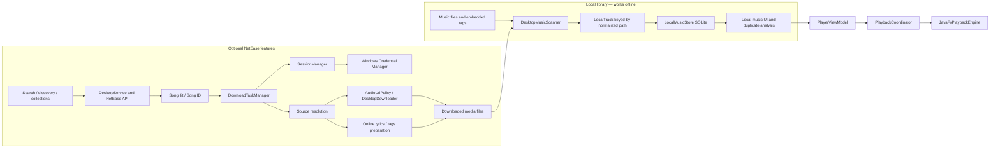

# P0 architecture baseline and minimum decoupling plan

This document records the P0 architecture baseline. The player described as future work below has since been partially implemented; see the current [Player P1 status](PLAYER-P1.md) for the JavaFX backend and remaining acceptance gates.

## Current dependency picture

## Findings from the current code

- `LocalTrack` identity is based on normalized file path. Moving a file creates a new local identity. Its metadata, technical parameters and optional SHA-256 live in the local SQLite index.
- The `LocalMusicStore` tables contain filesystem roots, local tracks and root/path membership. They do not contain NetEase song IDs or login state.
- Local scanning, indexing and duplicate analysis do not depend on `SessionManager`, cookies or a live API. They can operate offline.
- The local playback engine, queue and synchronized local lyrics are now implemented behind the player interface. The current OpenJFX backend supports the tested MP3, AAC-LC/M4A and PCM WAV samples; FLAC is unsupported and audible output/installed-package acceptance remains open.
- `DownloadTask` requires a NetEase `songId`; search, collection import, source resolution and post-processing are NetEase-aware. Download task history is a versioned JSON store, separate from the local music SQLite database.
- QR session credentials are stored through a Windows Credential Manager target; they are not part of the local library schema. Local tracks remain available when the account is signed out.
- Downloaded files can later be discovered as ordinary local files by the scanner, but there is no provider-neutral library ID linking the downloaded task record to a library track.
- Lyrics and audio-tag preparation currently use online NetEase metadata. File scanning and tag reading itself is local. The local library and online account are operationally separate, though both are owned by the same application.

## Minimal decoupling sequence

1. [Implemented] Keep the local file/path identity and SQLite schema stable while adding playback. The player accepts local file paths and does not depend on online providers or account state.
2. Introduce stable provider-neutral `LibraryTrackId` values and a separate `ProviderTrackRef(providerId, remoteId)` mapping. Do not put provider IDs into the core local track schema as the primary key.
3. Evolve new download records to use `providerId` plus `remoteTrackId`, retaining a NetEase adapter for existing JSON history. Keep old schema readers and define an explicit migration before changing serialization.
4. Define provider-neutral lyrics and artwork records. Store source/provenance separately from the editable local tags, so local playback and user tags survive logout or API changes.
5. Keep authentication inside provider modules. The local scanner, playback engine, local library store and local lyric files must not request a session.

P0 intentionally makes no SQLite or JSON schema change. The independent DMC preview uses its own `DesktopMusicCandidate` data root, so it does not mutate the previous Hachimi Desktop profile.
