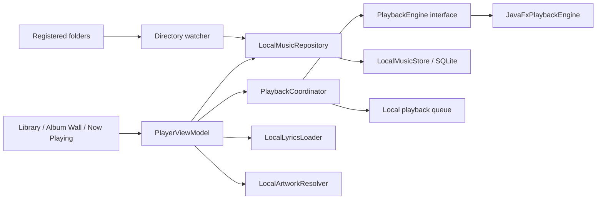

# DMC 本地播放器 P1 计划

**状态：P1 部分实现；本地播放后端、曲库播放入口和歌词/队列 UI 已接入，真实音频设备与安装版验收仍未完成。** 本计划基于 2026-10-13 的候选项目源码与依赖检查。目标是把 DMC 做成可离线使用的 Windows 本地音乐管理和播放应用，不依赖网易云登录，也不把在线音源地址交给播放器。

## 当前实施状态（2026-10-13）

已接入离线播放首版：LRC 时间戳解析、内嵌歌词与 `.lrc` / `.tl.lrc` / `.roma.lrc` 加载、播放状态协调器与队列控制、原子 JSON 队列保存/恢复、本地封面解析、曲库封面墙/搜索/目录监听、曲库行播放和批量播放入口、底部迷你播放器、Now Playing 歌词与队列窗口。应用创建和退出路径会创建并关闭播放器；队列可恢复，但应用启动后不会自动发声。

Windows 解码后端选用 OpenJFX Media 25.0.2，随 Gradle 依赖提供 Windows 原生媒体运行库。自动化集成测试在本机成功载入合成 MP3、AAC-LC/M4A 和 PCM WAV 文件并取得时长；这证明该环境中的媒体栈能识别这些样本，**不证明真实扬声器有声音，也不等价于安装包播放验收**。JavaFX 媒体栈不支持 FLAC；FLAC 曲目仍可进入曲库，但播放会返回不支持提示。安装包的运行库携带情况、音频设备输出、暂停/跳转/结束等真实播放行为仍待 Windows GUI 验收。没有引入未经核验的第三方 DLL。

本机从 Maven Central 对应的 Windows classifier 解析到以下 SHA-256；版本锁定在 `build.gradle.kts`，安装烟测会检查 classpath 与媒体 DLL。

| Artifact | SHA-256 |
|---|---|
| `org.openjfx:javafx-base:25.0.2:win` | `5da98b1134552ff47273cb49ded98c41982a8dd4d553c735d5a5b6d708294803` |
| `org.openjfx:javafx-graphics:25.0.2:win` | `eeef8f88b6862495d923a34f62f3015ebc462435f09ae846388a666dbb352a48` |
| `org.openjfx:javafx-media:25.0.2:win` | `fa5d4db47a40590b90c7fc6686d6585960492e99118584141d87cebb0a0dd99b` |

自动化覆盖歌词解析/来源优先级、队列损坏隔离与重启恢复、播放命令及队列推进、播放器 UI 关键控件、MP3/M4A/WAV 样本载入、本地封面回退、目录监听和筛选 UI。它们是单元/组件/媒体栈集成测试，**不能替代真实扬声器输出或 Inno 安装版验收**。

JDK 25 全量测试本轮执行结果：41 个 XML 测试报告、233 项通过，失败 0、错误 0、跳过 0。独立 `ffprobe` 对固定媒体夹具的检查如下；WAV 测试文件在测试中临时生成，测试完成后删除。

| 测试夹具 | 独立识别 | 时长 / 音频参数 | SHA-256 |
|---|---|---|---|
| `synthetic-tone.mp3` | MP3 | 10.031 秒；44.1 kHz、单声道 | `f4f975fd9de3547e82c3bf19b963433d5c1b085e276578e53082d04f8883ae3e` |
| `synthetic-tagged-aac.m4a` | MP4/M4A，AAC-LC | 2.024 秒；44.1 kHz、单声道 | `46b1039061f61eae7e8cb0bbe67c2066c1cef3fa2ea0993221cf0425cc7c6642` |
| 测试运行时生成的 WAV | WAV/PCM | 0.25 秒；44.1 kHz、16-bit、单声道 | 临时生成，未保留文件 |

仓库中还有一份 0.5 秒合成 FLAC 夹具，`ffprobe` 可读取；该事实不改变 JavaFX 后端不支持 FLAC 的结论。损坏 M4A 是负向夹具，不纳入可播放格式证明。

## 1. 现状和需要补齐的内容

当前代码已经能扫描音乐目录、把本地曲目索引到 SQLite、读取标签与技术参数、分析重复文件。扫描器按扩展名识别 MP3、FLAC、WAV、M4A/MP4；这只是索引分类，**不能证明这些文件都能播放**。第一批 UI 已有本地封面墙和标题搜索；目录监听可以按根目录选择开启，并在变更突发后合并重扫。

下载后处理代码已能生成普通 LRC、翻译与罗马音侧车歌词，并在受支持的下载格式上写标签。播放器目前具备 JavaFX 媒体适配器、播放状态/队列、曲库播放入口、mini-player 和 Now Playing 的歌词/队列 UI。现有播放器不访问在线接口。在线下载任务仍绑定网易云 Song ID；本地 `LocalTrack` 以规范化文件路径为身份，播放器 P1 不应把在线账号或 Song ID 引入本地播放模型。

## 2. P1 的用户体验目标

1. 首次启动时添加一个或多个音乐目录，扫描结束即可离线播放。
2. 以专辑封面墙浏览音乐，也能切换到歌曲、专辑和歌手列表，并快速搜索。
3. 从任意歌曲或专辑加入队列，能播放、暂停、上一首/下一首、拖动进度、调节音量、随机播放和循环播放。
4. 窗口底部常驻迷你播放器；点击封面或标题进入「正在播放」页面。
5. 正在播放页面突出显示封面和曲目信息，可显示本地同步歌词，并切换原文、翻译和罗马音轨。
6. 播放器只访问用户选定的本地文件与本地歌词/封面。无网络、未登录、会话过期时，播放能力不受影响。
7. 应用关闭时释放解码器和音频设备；下次打开不自动发声，提供恢复上次队列的明确操作。

## 3. 建议架构

- **PlaybackEngine**：封装播放、暂停、跳转、音量、时长/位置事件、错误与释放。UI 和队列不调用原生 API。
- **PlaybackCoordinator**：单一状态所有者，串行处理切歌、队列变化、解码器事件和应用退出；向 UI 发布不可变 `PlaybackState`。
- **PlaybackViewModel**：暴露播放控制和界面状态；由生命周期 scope 管理观察任务，不在 Compose 重组中重复创建播放器。
- **LocalMusicRepository**：从当前 SQLite 索引提供曲目、专辑、歌手和搜索结果。P1 不改变现有索引 schema。
- **LocalLyricsLoader**：优先读内嵌同步歌词，其次读取同目录侧车文件；解析失败只显示歌词不可用，不阻断音频。
- **LocalArtworkResolver**：优先提取文件内嵌封面，再找同专辑目录的 `cover`、`folder`、`front` 图片，最后显示占位图。缩略图缓存放入 DMC 应用数据目录，不改写源音频和图片。
- **DirectoryWatcher**：只监听用户注册的目录；事件防抖后更新索引。事件队列溢出或盘符离线后，恢复时触发受控增量/完整扫描。
- **SessionManager / DesktopService**：不进入上述依赖链。播放器只接受规范化后的本地文件路径，不接受 URL、Cookie 或网络会话。

本地曲目目前用路径作身份，因此移动文件后会被当作新路径重新索引。P1 先保持兼容；更稳健的稳定曲目 ID 和路径别名放入后续数据迁移任务，不为了播放器改写 SQLite 主键。

## 4. 播放后端评估与决策

原型阶段比较了 libmpv/JNA、JavaFX Media 和 VLCJ。当前选择 JavaFX Media 25.0.2：不需要额外下载/管理一组第三方播放器 DLL，Windows classifier 可以随应用依赖解析；本机集成测试能读 MP3、AAC-LC/M4A 和 PCM WAV 样本。其不足是 FLAC 不受支持，且必须验证 jpackage/Inno 输出是否包含 JavaFX 的 Windows 原生媒体文件。若产品要求 FLAC 播放，应另立后端评估与许可证门，不得仅凭扩展名宣称支持。

| 方案 | 优点 | 需要验证/代价 | 结论 |
|---|---|---|---|
| JavaFX Media 25.0.2（当前原型） | JavaFX Media API 与 JDK 应用整合；Windows classifier 通过依赖解析随项目构建；本机样本加载测试通过。 | 上游采用 GPLv2 with Classpath Exception；原生媒体模块布局需核查；当前不支持 FLAC；未验安装包音频设备输出。 | 暂作 P1 后端。通过 Windows 安装版检查前不算分发验收通过。 |
| **libmpv + JNA** | mpv 官方建议把 libmpv 作为嵌入式播放后端；C API 适合由 Kotlin/JNA 包装，格式覆盖更广。 | 需固定 DLL 与全部依赖 DLL，验证 Windows 打包和退出释放；默认 mpv 为 GPL，官方说明可在排除 GPL-only 文件且核验链接库后构建 LGPL 模式。必须检查实际二进制构建参数、FFmpeg/其他依赖许可证和 LGPL 再链接要求。 | 如果 P1 必须覆盖 FLAC，作为后续替代候选重新验证；未完成版本、许可和可复现来源核验前不引入。 |
| VLCJ | 功能成熟，VLC 解码器覆盖面广。 | 要随应用部署 VLC 原生运行库，安装体积与原生集成更大；还需逐项核对 vlcj 与 VLC 的许可证及再分发条件。 | 不作为首选；若后端原型失败再比较。 |

mpv 官方文档说明 libmpv 用于嵌入其他程序，并提供 C API；Windows 文档展示了 `libmpv` DLL 构建和相关 DLL 部署要求。mpv 的版权说明区分默认 GPL 构建与满足条件的 LGPL 构建，同时提醒链接库也会影响最终许可证。[libmpv 嵌入说明](https://github.com/mpv-player/mpv/blob/master/DOCS/man/libmpv.rst)、[Windows 构建说明](https://github.com/mpv-player/mpv/blob/master/DOCS/compile-windows.md)、[mpv 版权与 LGPL 模式说明](https://github.com/mpv-player/mpv/blob/master/Copyright)。

OpenJFX 25 文档列出 MP3、AAC、PCM 编码及 MP3、MP4/M4A、WAV 容器组合；该列表用于筛选候选格式，不替代本项目样本和安装包验证。[JavaFX 25 支持的媒体类型](https://openjfx.io/javadoc/25/javafx.media/javafx/scene/media/package-summary.html)、[OpenJFX 许可说明](https://openjfx.io/)。

- 已用本地合成样本载入 MP3、M4A/AAC-LC、WAV PCM，并验证媒体就绪与正时长；尚未验证 FLAC（JavaFX 不支持）或通过安装包运行这些样本。需为测试样本记录容器、编码、时长和 SHA-256。
- 对损坏文件、扩展名与内容不匹配、缺失 DLL、音频设备不可用，返回可读错误并保证应用仍可操作。
- 验证播放/暂停/seek/音量/结束事件、连续切歌、停止后释放；原生事件不得阻塞 Compose UI 线程。
- 已将 OpenJFX 25.0.2 Windows 分类器加入运行时依赖并更新许可证清单；本地 `createDistributable` 输出包含 JavaFX base/graphics/media Windows jars，media jar 内含 `jfxmedia.dll`，jpackage runtime 内含 JDK `legal/` 目录。Inno 烟测新增安装后断言；本机缺少 Inno 编译器，尚未运行安装器验收。
- 仍需将播放器放入实际 Inno 安装包，在干净 Windows 账户中确认无需开发 JDK 或额外安装播放器即可运行，并完成真实设备输出测试。
- 不引入外置播放器 DLL；已记录 Maven 版本与 Windows artifact SHA-256，并检查 JavaFX 原生媒体载荷和许可证文本。仍需由 CI 编译 Inno 并验证打包、安装路径内的许可文件和卸载保留行为；没有安装包烟测与运行验收记录，不关闭此门。

## 5. P1 功能分阶段

### P1.1 播放核心与队列

**状态：核心接口、队列控制、曲库播放入口和持久化已实现；真实设备/安装包验收未完成。**

- 支持从本地曲目、专辑和搜索结果开始播放；队列项保存本地 Track ID 和可重新验证的文件路径，不保存远程签名 URL。
- 支持播放/暂停、上一首/下一首、播放进度、跳转、音量、随机、单曲循环/列表循环、队列添加/移除/排序/清空。
- 上一首按常见桌面行为处理：当前曲目播放超过约 3 秒时从头播放，否则回到上一首；切换/结束行为由单元测试固定。
- 音频结束、文件失联、解码失败、用户删除队列项由 Coordinator 统一处理。单曲失败不应让播放器或曲库页面崩溃。
- 队列与上次曲目可原子保存到 DMC 本地设置。重启时询问是否恢复；默认不自动播放。无法找到的路径显示为缺失项并允许移除。

### P1.2 曲库、封面墙和桌面控制

**状态：封面墙/搜索/目录监听以及 mini-player、Now Playing 窗口已实现；曲库列表视图扩展、快捷键和真实 GUI 验收仍待完成。**

- 本地音乐页提供「专辑 / 歌曲 / 歌手」视图，支持标题/歌手/专辑搜索、排序、格式筛选和空库引导。
- 专辑墙使用响应式网格；窗口缩放和 DPI 改变时重排。封面统一裁切，不修改原图；缺失、损坏或不支持的封面显示占位图和可读提示。
- 底部常驻 mini-player 显示小封面、曲名、歌手、上一首/播放暂停/下一首、进度和音量，并提供队列、歌词和展开按钮。
- Now Playing 页面根据封面形成柔和背景，呈现大封面、曲目信息、进度/控制区；宽屏可并列显示队列与歌词，小窗口改为纵向滚动。
- 支持应用内快捷键：Space 播放/暂停、方向键短跳转、Ctrl+方向键切曲。全局媒体键和复杂音频设备选择暂放 P2。

### P1.3 本地歌词与翻译/罗马音

**状态：读取、时间同步、高亮与原文/翻译/罗马音切换已实现；真实播放时歌词跟随需要设备验收。**

- 读取音频标签内的普通同步歌词，以及与歌曲同名的 `.lrc`、`.tl.lrc`、`.roma.lrc` 侧车文件；这些侧车后缀与现有下载后处理约定一致。
- 时间戳驱动当前行高亮；seek、暂停、切歌、歌词缺失、时间戳无序或重复时均有确定行为。
- 歌词区可切换原文、翻译和罗马音，也支持并排显示原文与已存在的翻译/罗马音。不同文件的时间戳按就近匹配；无法匹配时不伪造逐字对齐。
- P1 只读取已存在的歌词，不联网抓取、不自动翻译、不自动生成罗马音、不写回音频标签。YRC 逐字歌词动画放 P2/P3。

### P1.4 目录监听和恢复

**状态：可选根目录监听及已注册目录自动重扫已实现；睡眠唤醒/外置盘重连边界仍需实际 Windows 验收。**

- 添加根目录后执行当前扫描器；用户可对每个根目录开启/关闭自动监听。
- 使用 WatchService 并为新增/修改/重命名/删除事件做防抖；批量复制大量文件时合并变更，避免每个文件都启动一次完整扫描。
- 监听事件溢出、睡眠唤醒、应用重启、外置盘重连时进行有界补扫；重复根目录和符号链接/循环目录必须被过滤。
- 移除根目录只删除索引关系，不删除任何音频、歌词、封面或下载文件。播放中的文件被移走时暂停并提示，不能挂死原生播放器。

## 6. 格式承诺

当前原型验证过的样本为 MP3、AAC-LC/M4A 和 WAV/PCM。JavaFX 后端不支持 FLAC，因此它不属于本版本可播放格式；扫描器仍能把 FLAC 纳入曲库，尝试播放时显示“不支持”。已验证格式仍须在 Inno 安装版和真实音频设备上复核。ALAC、AAC 其他 profile、APE、DSD、OPUS、WMA 等暂不承诺；界面依据引擎实际结果显示「可播放 / 不支持 / 文件损坏」，不能只按扩展名说已支持。

不宣称 bit-perfect、独占输出、无损重采样或特定高解析音质。默认使用 Windows 默认音频设备与系统音量路径；这些音频输出优化须有单独的后端验证和设备测试后再规划。

## 7. 自动化和手工验收

| 层级 | 必须覆盖 |
|---|---|
| 单元测试 | 队列顺序/重复项/删除/随机与循环；状态机；上一首阈值；seek/播放进度事件；丢失文件；错误恢复；歌词解析、时间匹配与切歌清理；封面解析回退；Watcher 防抖、溢出和重连策略。 |
| 后端集成测试 | 已测试 MP3、M4A/AAC-LC、WAV/PCM 本地样本载入和时长；未测试 FLAC（明确不支持）、播放结束、扬声器输出与安装包内解码。还需覆盖暂停/seek/音量、损坏样本和无网络播放。无音频设备的 CI 使用 FakePlaybackEngine，真实后端验证在 Windows job/本机 smoke 中完成。 |
| UI 验收 | 添加目录、查看封面墙、搜索、从专辑加入队列、播放和暂停、切歌、seek、音量、打开 Now Playing、切换翻译/罗马音、窗口缩放、高 DPI、缺封面/缺歌词状态。 |
| 安装包验收 | 待验证 Inno 安装包内 OpenJFX Media jar、Windows 原生媒体文件及 JDK legal notices；清洁账户启动；在安装版测试 MP3、M4A、WAV 播放与真实输出；检查升级兼容及卸载时用户音乐/歌词/封面不受影响。 |
| 文件保护 | 播放、扫描、读取歌词/封面前后对测试源文件比较长度与 SHA-256；所有测试文件保持逐字节不变。 |

## 8. 完成门槛、风险与排除范围

只有 P1-A 后端/许可验证通过、P1.1–P1.4 功能测试通过、安装包内播放验证完成，并且本地文件只读保护通过，才能把 P1 标成 PASS。源码编译通过或 FakePlaybackEngine 通过都不能替代 Windows 原生解码与真实音频设备验收。

主要风险是 OpenJFX 原生媒体载荷与许可证通知、JavaFX Toolkit/播放器生命周期、FLAC 缺失、不同 Windows 音频设备行为、扫描目录变更竞态、歌词时间戳格式差异，以及产品品牌迁移时误改现有数据路径。应通过版本锁定、可替换的 FakePlaybackEngine、原子状态所有权、真实安装包 smoke 和数据迁移测试控制。

P1 不包含在线流媒体播放、远程歌词/元数据抓取、自动翻译或音译、音频标签批量写入、歌词逐字动画、均衡器/DSP、跨设备遥控、公开发布或大规模 UI 重设计。在线发现和下载继续由现有 provider 模块处理。
