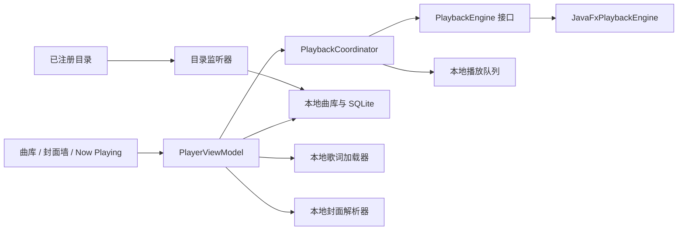

# DMC 本地音乐播放器 P1 规格与验收

**状态：P1 部分完成。** 本地播放器、队列、歌词界面、JavaFX 媒体适配器和 Inno 安装器烟测已实现或通过自动化验证；真实 Windows 安装版的可听播放和完整窗口操作仍未验收。本文记录 DMC 的播放器范围、技术边界和收口标准。

## 1. 产品目标

DMC 是独立的 Windows 桌面音乐管理与播放应用。播放器以用户选择的本地音乐文件为中心，可浏览封面墙、播放队列中的曲目，并在正在播放页面显示歌词原文、翻译和罗马音。

播放器应当在离线、未登录或网易云会话过期时继续工作。它不使用网易云 Song ID、Cookie、登录会话或在线音源 URL 作为本地音乐身份，也不把远程下载地址交给播放引擎。

## 2. P1 用户流程

1. 用户添加一个或多个本地音乐目录，扫描后浏览曲库。
2. 用户通过专辑封面墙、歌曲/专辑/歌手列表或搜索找到曲目。
3. 用户从曲目或专辑开始播放，或将选择添加到队列。
4. 窗口底部的迷你播放器保持可用；点击曲名或封面可打开正在播放窗口。
5. 正在播放窗口显示专辑封面、曲目信息、进度、播放控制和本地可用歌词。
6. 应用重启后可恢复上次队列供用户选择继续，不应自动发声。

## 3. 功能范围与状态

### P1.1 播放核心和队列

**已实现并有自动化覆盖：**

- 从本地曲库条目开始播放或添加到队列。
- 播放、暂停、上一首、下一首、进度跳转和音量控制。
- 队列保存、恢复、追加、移除、清空、随机播放和循环模式。
- 当前播放状态由 `PlaybackCoordinator` 统一管理，界面不直接改写引擎状态。
- 恢复上次队列时不自动播放；缺失的本地文件应可显示并安全跳过或移除。
- 应用关闭时释放播放引擎，避免残留媒体线程或设备占用。

**仍需实机确认：**真实设备上的播放、暂停、跳转、音量、曲目结束后的队列推进、快速切歌、设备拔除和应用退出行为。

### P1.2 曲库浏览和播放器界面

**已实现：**

- 本地曲库提供封面墙和搜索入口；曲目可播放或排入队列。
- 底部迷你播放器显示当前曲目并打开 Now Playing 页面。
- Now Playing 页面显示封面、曲目信息、进度、播放控制、歌词和队列控制。
- 可在歌词原文、翻译、罗马音之间切换，并根据播放时间高亮当前行。

**后续改进优先级：**

1. 在真实窗口上检查窄窗口、宽屏、缩放和高 DPI 下的布局、文本裁切与滚动。
2. 为队列增加拖动排序，并完善空曲库、缺封面、无歌词、曲目文件丢失等状态。
3. 增加应用内快捷键：空格播放/暂停，方向键短跳转，Ctrl+方向键切曲。快捷键必须尊重文本输入焦点，避免误触。
4. 评估全局媒体键和系统媒体信息；它们不作为 P1 完成条件。

### P1.3 本地歌词

**已实现并有自动化覆盖：**

- 读取音频文件内的同步歌词，以及与音频同目录、同曲名的 `.lrc`、`.tl.lrc`、`.roma.lrc` 侧车文件。
- 解析时间戳并根据播放位置选择当前歌词行；暂停、跳转或切歌后同步更新。
- 支持只显示原文、翻译、罗马音，也可并排显示已存在的对应文本。
- 某轨歌词缺失或格式错误时只显示不可用状态，不影响音频播放。

P1 不联网抓取歌词、不自动翻译、不自动生成罗马音、不将歌词写回音频标签，也不承诺不同来源歌词之间能够逐字对齐。

### P1.4 曲库扫描、封面和目录监听

**已实现：**

- 曲库通过本地文件路径和现有 SQLite 索引管理曲目，不依赖在线平台身份。
- 识别 MP3、FLAC、WAV、M4A/MP4 等候选文件并读取可用元数据。
- 封面优先读取音频内嵌图片，再查找专辑目录中的 `cover`、`folder`、`front` 等图片，缺失时显示占位图。
- 可选监听用户注册的目录；事件防抖后更新索引。
- 移除索引目录只移除应用中的索引关系，不删除或改写用户音乐文件。

目录监听的睡眠唤醒、外置盘断开重连、监听事件溢出和大量文件复制后的扫描合并仍需要 Windows 实机测试。

## 4. 模块边界

- **Compose Screens**：只负责展示状态和发出操作。
- **PlayerViewModel**：将用户操作转为协调器命令，并向界面提供不可变状态。
- **PlaybackCoordinator**：队列和当前曲目的唯一状态所有者，协调切歌、队列推进、持久化和播放引擎事件。
- **PlaybackEngine**：播放、暂停、seek、音量、进度/结束/错误事件和资源释放的抽象。
- **JavaFxPlaybackEngine**：P1 采用的 Windows 媒体适配器。
- **本地曲库、歌词和封面加载器**：只读用户选定的本地内容；除索引数据库和应用缓存外，不修改源媒体文件。
- **DesktopService / SessionManager**：不属于播放器依赖链。播放器不需要网络或账号认证。

## 5. 媒体后端选择和格式承诺

当前后端为 OpenJFX Media 25.0.2 Windows classifier。其优点是 JVM 应用可直接通过 Gradle 依赖打包，并能随应用镜像携带 Windows 媒体原生库；自动化媒体测试已能载入 MP3、AAC-LC/M4A 和 PCM WAV 合成样本并读取时长。

| 方案 | 优点 | 代价与待核查事项 | 当前决定 |
|---|---|---|---|
| OpenJFX Media 25.0.2 | Java API 与桌面应用集成直接；Windows 运行库可由 Gradle 解析并随包分发 | 未列出 FLAC 支持；需检查原生库、依赖许可、真实输出设备和安装版行为 | 当前 P1 后端 |
| libmpv + JNA | 格式覆盖广，适合作为 FLAC 等格式的后端候选 | 需分发并核查 DLL 依赖、构建来源、GPL/LGPL 配置及再链接义务 | 仅在确认格式需求后做独立评估 |
| VLCJ | 解码覆盖成熟 | 随包分发体积和原生依赖较大，需逐项核查 VLC 与绑定库许可 | 当前不引入 |

当前可承诺的候选格式以测试和实际解码结果为准：MP3、AAC-LC/M4A、PCM WAV 已有合成样本载入测试；**测试读取时长不等同于扬声器确实发声**。JavaFX Media 不支持 FLAC，因此 DMC 当前播放器明确将 FLAC 显示为不支持播放；能够扫描或索引文件不代表能够播放。APE、DSD、Opus、WMA、其他 AAC profile 等格式也不做兼容承诺。

不宣称 bit-perfect、独占音频设备、无损重采样或特定高解析度输出。默认走 Windows 音频设备和系统音量路径。

## 6. 文件保护、错误处理和隐私

- 播放器只接收经过本地路径校验的音频文件，不接收 HTTP/HTTPS URL、Cookie 或会话对象。
- 扫描、播放、读取歌词和读取封面均不得改写源媒体文件。
- 损坏文件、缺失文件、缺失解码库和不支持格式应转换为曲目级可读错误，不应使曲库或窗口崩溃。
- 队列持久化只保存本地曲目身份/路径和播放设置，不保存远程签名 URL 或登录凭据。
- 任何歌词来源不匹配时，不伪造翻译或罗马音，也不伪造逐字时间同步。

## 7. 自动化与手工验收

### 自动化验收

- 播放协调器：队列顺序、去重/移除、随机/循环、上/下一首、结束推进、错误隔离和队列恢复。
- 歌词：LRC 时间戳解析、轨道选择、翻译/罗马音加载、跳转/暂停同步和切歌清理。
- 曲库与 UI：曲目播放入口、封面回退、搜索/过滤、目录监听防抖和曲目缺失状态。
- 媒体栈：MP3、AAC-LC/M4A、PCM WAV 合成样本载入；损坏或不支持样本应返回可读错误。
- 文件保护：对测试源音频、歌词和封面在操作前后比较文件长度及 SHA-256。

### Windows GUI 与安装版验收

1. 从安装版开始菜单入口启动，确认无需单独安装开发 JDK。
2. 扫描本地目录，打开封面墙并从曲目开始播放。
3. 在实际输出设备听到声音，验证暂停、跳转、音量、结束推进和切歌。
4. 打开 Now Playing，切换原文/翻译/罗马音，检查歌词与播放位置同步。
5. 窗口缩放、高 DPI、空库、缺失文件、无封面和无歌词状态均可操作。
6. 退出后重新启动，确认队列恢复但不自动播放；卸载不删除用户曲库文件和应用数据。

必须分别记录单元测试、媒体栈载入测试、CI 安装器烟测和真实 GUI/设备验收，不可互相替代。

## 8. 当前验收记录（2026-10-13）

- 本机 JDK 25：`./gradlew.bat --no-daemon test --rerun-tasks`，233 项测试，41 份 XML 报告，0 失败、0 错误、0 跳过。
- 本机 `createDistributable` 成功；检查到 OpenJFX Windows base/graphics/media JAR、`javafx-media` 中的 `jfxmedia.dll` 和捆绑 JDK 的 `runtime/legal`。
- 本机 `packageExe` 成功，产物为 `DesktopMusicCandidate-0.1.2.exe`；这是构建检查，不是新版本发布。
- GitHub Actions [run 38350307463](https://github.com/ChangfengluoO71/desktop-music-candidate/actions/runs/38350307463) 在 JDK 25 上通过 Windows 全量测试和 Inno Setup 安装器烟测。烟测验证自定义安装目录、捆绑 JVM/OpenJFX 媒体库与许可文件、开始菜单/桌面快捷方式、卸载和测试用户数据保留。发布步骤因 `publish_preview=false` 跳过，没有创建 Release。
- CI 未上传 JUnit XML，因此该次 Windows 运行的精确通过/跳过数量未记录。JavaFX 媒体测试有输出端点预检；CI 绿色结果不能证明测试机存在可用扬声器或实际发声。
- **未完成：**未在用户本机安装或启动该安装器；未实测安装后的应用窗口、真实扬声器输出、播放/暂停/跳转/结束行为、高 DPI 和升级兼容性。当前阶段判定为 **P1_PARTIAL**，不得标为 P1_PASS。

## 9. P1 收口顺序与范围外功能

1. 使用安装版进行真实 Windows GUI 与音频设备验收；修复并回归播放、切歌、设备不可用和退出问题。
2. 验证窗口缩放、高 DPI、空曲库、损坏文件、缺封面/歌词和离线使用体验。
3. 决定 FLAC 是否属于当前产品必须支持的格式；如需要，再完成 libmpv/VLCJ 的许可、打包体积和安装版原型评估，不在未验证前引入后端。
4. 根据实机反馈完善队列拖动排序与不抢占文本输入的快捷键。
5. 对本地只读保护、队列恢复、升级和卸载保留行为补齐最终证据，再单独将 P1 状态更新为通过或列明剩余阻塞。

P1 不包括在线流媒体播放、在线歌词抓取、自动翻译或罗马音生成、标签批量写入、均衡器/DSP、全局媒体键、远程遥控、云同步、自动更新或公开发行验收。
